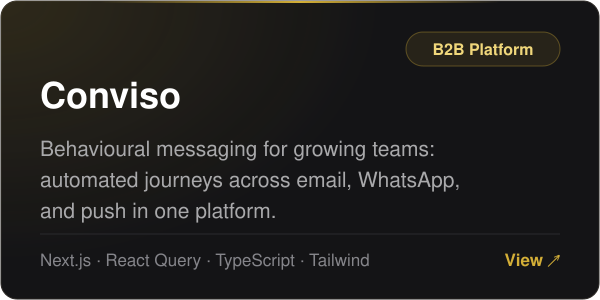
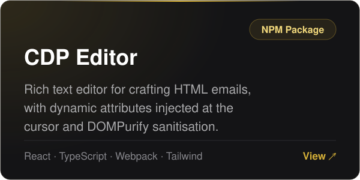
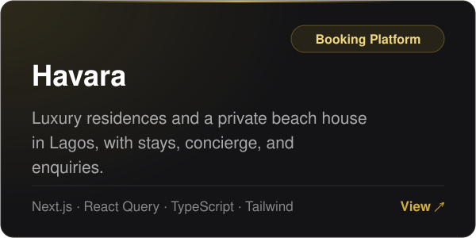
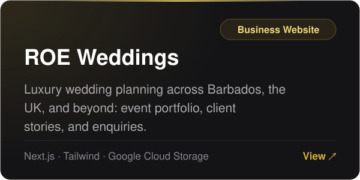
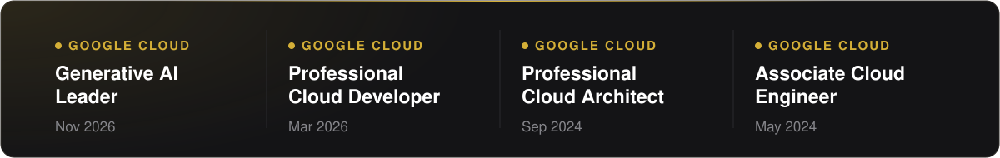

  

  
  
  

 

I turn complex products into fast, dependable interfaces. Over five years I've shipped customer platforms, data-heavy dashboards, and published NPM packages, and I own the frontend architecture behind them: component systems, state and data fetching, performance, and the tooling that helps teams ship faster.

I also hold four Google Cloud certifications, so I think beyond the browser: how the UI is served, scaled, and kept fast in production.

## Selected work

  
  
  
  

  CDP Editor source: <a href="https://github.com/Phoreverr/openCDP-editor">openCDP-editor</a> · More client work on my <a href="https://phorever-dev.vercel.app">portfolio</a>

## Tech stack

  
   
  

## Certifications

  

Off the keyboard: anime, Call of Duty Mobile, lifting, and travelling.

